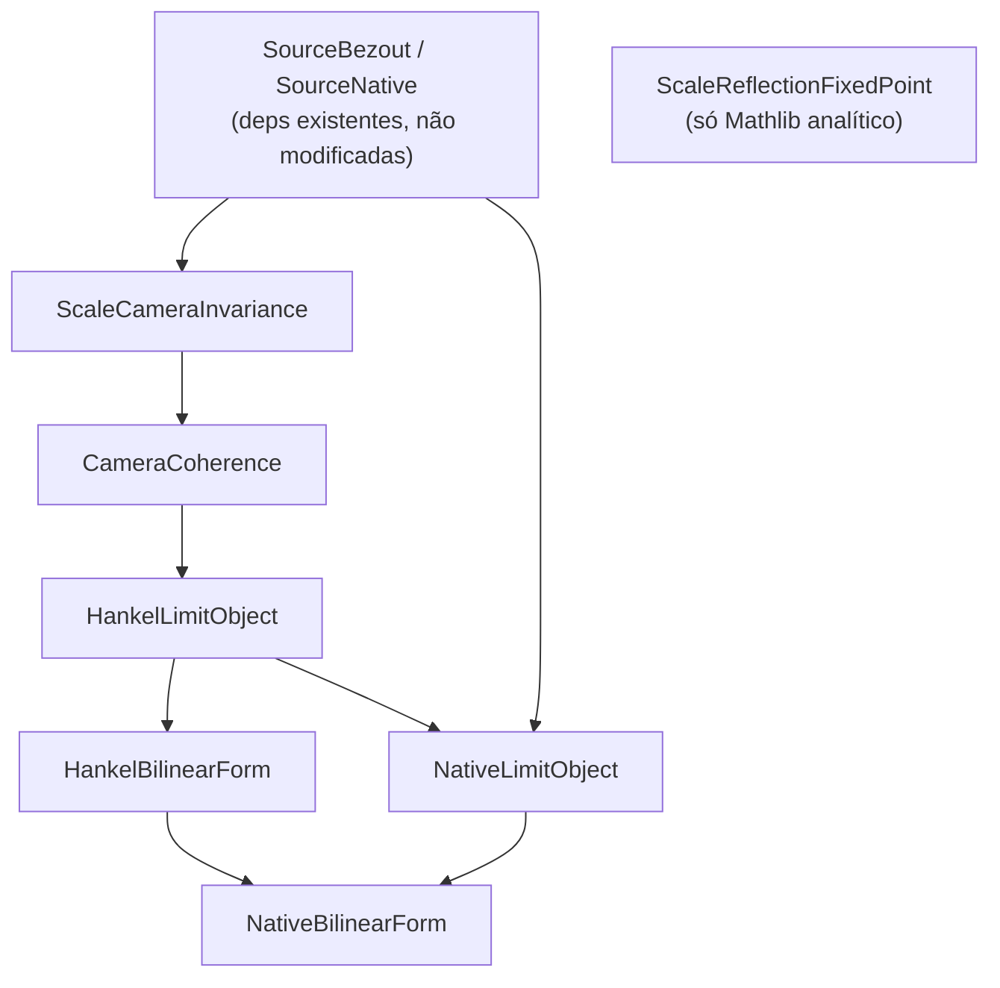
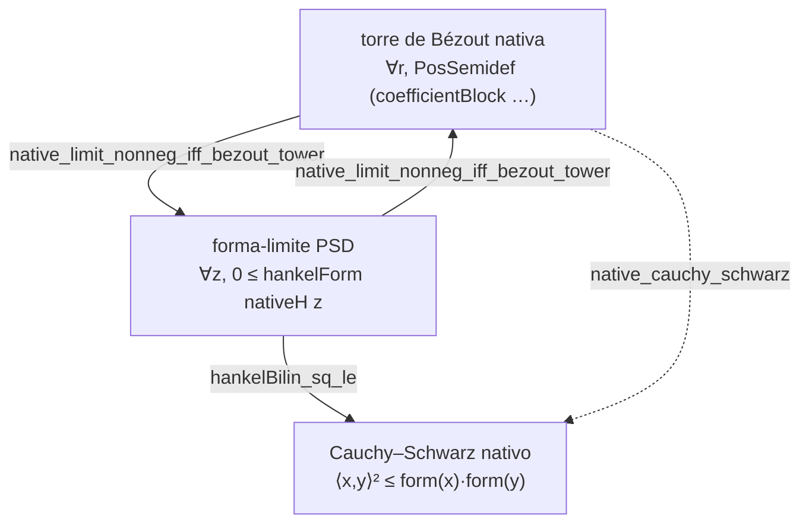

# O arco intrínseco: invariância de escala, matriz e sinal

**Escopo honesto.** Este relatório consolida um arco de módulos Lean 4 que formalizam uma
leitura **intrínseca** de uma lei de escala: *o que não muda quando tudo muda*. O conteúdo
é sobre **matriz e sinal** — formas quadráticas de Hankel, congruência, positividade
semidefinida e a forma bilinear que as polariza. **Não** é sobre localização de zeros, e
**não** afirma nem é equivalente à Hipótese de Riemann. Onde há hipóteses (p.ex. a torre
de Bézout nativa ser positiva semidefinida), elas aparecem explicitamente como hipóteses;
os teoremas dizem *o que a geometria mostra se elas valem*.

Todos os módulos compilam no pin corrente (Lean 4 v4.32.0, Mathlib 81a5d257) com
`-DwarningAsError=true`, e todas as declarações dependem **apenas dos axiomas padrão**
`[propext, Classical.choice, Quot.sound]`.

---

## 1. O fio condutor

| Tema | Onde | Afirmação |
|---|---|---|
| O ponto fixo `1/2` | `ScaleReflectionFixedPoint` | o inclinamento normalizado refletido é `≥ 0`, com igualdade **sse e só se** `δ = 0` |
| Sinal é invariante de câmera | `ScaleCameraInvariance` | mudar a câmera (congruência por unidade) **preserva** `PosDef` e o sinal do determinante |
| A torre é coerente | `CameraCoherence` | positividade em ordem `R` desce para toda ordem `r ≤ R` (leitura projetiva consistente) |
| Existe um objeto-limite | `HankelLimitObject` | a positividade da forma em `ℕ →₀ ℝ` **é** a torre consistente das câmeras finitas |
| Ancorado na fonte nativa | `NativeLimitObject` | o objeto-limite nativo **é** exatamente a torre de Bézout nativa |
| A forma é polarizada | `HankelBilinearForm` | a quadrática-limite tem forma bilinear simétrica; Cauchy–Schwarz se PSD |
| Cauchy–Schwarz nativo | `NativeBilinearForm` | a torre de Bézout nativa torna a forma nativa um produto interno PSD |

---

## 2. Grafo de dependências dos módulos



`ScaleReflectionFixedPoint` é independente (só usa `Mathlib.Analysis.SpecialFunctions`);
os demais formam a cadeia `SourceBezout → ScaleCameraInvariance → CameraCoherence →
HankelLimitObject`, com a fonte nativa entrando em `NativeLimitObject` e a forma bilinear
coroando em `HankelBilinearForm`/`NativeBilinearForm`.

---

## 3. Catálogo de teoremas

### 3.1 `ScaleReflectionFixedPoint` — o ponto fixo `1/2`
- `two_le_rpow_add_rpow_neg` : para `a > 0`, `2 ≤ a^δ + a^(-δ)`.
- `rpow_add_rpow_neg_eq_two_iff` : para `a > 0`, `a ≠ 1`, `a^δ + a^(-δ) = 2 ↔ δ = 0`.
- `reflectedNormalizedTilt_reflection` : invariante sob `δ ↦ -δ` (simetria de reflexão).
- `reflectedNormalizedTilt_nonneg` / `_eq_zero_iff` / `_pos_of_ne_zero` : é `≥ 0`, e **zera
  exatamente em `δ = 0`** — o ponto fixo da reflexão de escala é não-degenerado.

### 3.2 `ScaleCameraInvariance` — o sinal invariante de câmera
- `posDef_congr_transpose_iff` : `(U M Uᵀ).PosDef ↔ M.PosDef` para `U` unidade.
- `smul_posDef_iff` : escalar positivo não muda `PosDef`.
- `isUnit_convolutionMatrix` : a matriz de transição é unidade quando `c 0 ≠ 0`.
- `native_posDef_camera_invariant` : a leitura de Bézout e a leitura de momentos têm a
  **mesma** `PosDef`, em cada ordem.
- `native_det_sign_camera_invariant` : o **sinal do determinante** é invariante de câmera.
- `hankelMatrix_rescale` / `hankel_rescale_posDef_iff` : reescalar a sequência por `C·Bⁿ`
  (com `C, B > 0`) não muda a positividade.

### 3.3 `CameraCoherence` — a torre projetiva coerente
- `convolutionMatrix_castLE` / `hankelMatrix_castLE` / `coefficientBlock_castLE` : a câmera
  de ordem `r` é o prefixo (submatriz por `Fin.castLE`) da câmera de ordem `R`.
- `hankel_posDef_mono` / `native_bezout_posDef_mono` : `PosDef` em `R` ⟹ `PosDef` em `r ≤ R`.
- `native_reading_tower` : a leitura nativa é uma **torre coerente** de positividades.

### 3.4 `HankelLimitObject` — o objeto-limite explícito
- `hankelForm h s x = ∑_{i,j} x i · h(i+j+s) · x j` em `ℕ →₀ ℝ`.
- `hankelForm_embDomain` : a forma-limite num vetor incluído da câmera `r` **é** a forma
  finita de `hankelMatrix h s r`.
- `hankelForm_nonneg_iff_tower` : **a passagem ao limite** —
  `(∀ x, 0 ≤ hankelForm h s x) ↔ ∀ r, (hankelMatrix h s r).PosSemidef`.

### 3.5 `NativeLimitObject` — ancoragem na fonte nativa
- `nativeC_zero_pos` : `0 < nativeC 0` (via `nativeC 0 ≥ 1/3`), o que torna a transição invertível.
- `posSemidef_congr_transpose_iff` : congruência preserva/reflete `PosSemidef`.
- `native_hankel_posSemidef_iff_bezout` : em cada ordem, câmera de momentos nativa e câmera
  de Bézout nativa têm a mesma `PosSemidef`.
- `native_limit_nonneg_iff_bezout_tower` : **o círculo fechado (lado matricial)** —
  `(∀ x, 0 ≤ hankelForm nativeH (if b then 1 else 0) x) ↔ ∀ r, (coefficientBlock
  (sourceKernel nativeC b) r).PosSemidef`.

### 3.6 `HankelBilinearForm` — a forma bilinear polarizada
- `hankelBilin h s x y = ∑_{i,j} x i · h(i+j+s) · y j`.
- `hankelBilin_self` : diagonal = quadrática (`hankelBilin x x = hankelForm x`).
- `hankelBilin_comm` : simetria (o núcleo `h(i+j+s)` é simétrico em `i,j`).
- `hankelBilin_add_left/right`, `hankelBilin_smul_left/right` : **bilinearidade plena**.
- `hankelForm_smul` : `hankelForm (c • x) = c² · hankelForm x` — a câmera escala por `c² ≥ 0`,
  logo **o sinal é invariante de escala**.
- `hankelForm_add` : **identidade de polarização**
  `hankelForm (x+y) = hankelForm x + hankelForm y + 2 · hankelBilin x y`.
- `hankelBilin_sq_le` : **Cauchy–Schwarz do objeto-limite** — se a forma-limite é PSD, então
  `hankelBilin x y ² ≤ hankelForm x · hankelForm y`.

### 3.7 `NativeBilinearForm` — Cauchy–Schwarz nativo
- `native_cauchy_schwarz` : **o círculo fechado (lado bilinear)** — se a torre de Bézout
  nativa é PSD em cada ordem, então
  `hankelBilin nativeH (if b then 1 else 0) x y ² ≤ hankelForm nativeH … x · hankelForm nativeH … y`.

---

## 4. Os dois círculos



- **Lado matricial / sinal.** `native_limit_nonneg_iff_bezout_tower` : a positividade do
  objeto-limite nativo **é** a torre consistente da leitura de Bézout nativa (equivalência).
- **Lado bilinear / geometria.** `native_cauchy_schwarz` : essa mesma positividade torna a
  forma de momentos nativa um produto interno PSD, e vale Cauchy–Schwarz (implicação).

---

## 5. Auditoria de axiomas

Todas as declarações-chave foram verificadas com `#print axioms` e dependem **somente** de:

```
[propext, Classical.choice, Quot.sound]
```

Sem axiomas custom, sem `sorry`, sem `native_decide`. Cada módulo foi compilado
individualmente via `bash compile.sh <Módulo>` com `-DwarningAsError=true`.

---

## 6. O que está provado vs. o que fica em aberto

**Provado (incondicional):**
- o ponto fixo `1/2` da reflexão de escala é não-degenerado;
- invariância de câmera do sinal (`PosDef`, sinal do determinante);
- coerência projetiva da torre;
- existência e caracterização do objeto-limite;
- a equivalência objeto-limite nativo ⟺ torre de Bézout nativa;
- polarização completa e Cauchy–Schwarz **sob** PSD.

**Em aberto (hipótese explícita, não afirmada aqui):**
- que a torre de Bézout nativa seja de fato positiva semidefinida em toda ordem. Os
  teoremas `native_*` são **condicionais** a isso, e é exatamente aí que a geometria
  concentra o conteúdo: *matriz e sinal*.

---

*Matriz e sinal, forma bilinear, fonte nativa; nada de zeros, nada de RH. Nenhum arquivo
pré-existente foi modificado — o arco inteiro é aditivo.*
