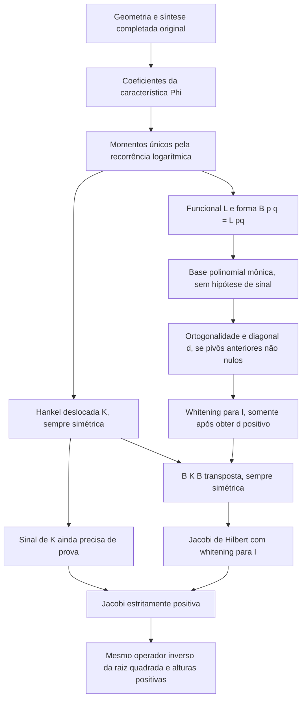

# Auditoria da direção lógica da ortogonalização nativa

**Resultado: PARTIAL.** A leitura em coordenadas polinomiais pode ser construída
sem positividade e sem inversibilidade. A ortogonalização algébrica funciona sob
não anulação dos pivôs anteriores. Esses resultados não determinam o sinal dos
auto-pareamentos. A exigência de positividade foi retirada de consumidores que
só precisam de simetria; ela permanece necessária para whitening quadrado para
a identidade e para alturas reais positivas do operador especificado.

Base: `origin/main`, commit `59e53d863f4ef0ad998b0eb19fd3891c9839cc35`.
Branch independente: `agent/native-moment-orthogonalization-audit`.
Lean `v4.32.0`; dependências e pins preservados. Somente arquivos novos em
`research/native-moment-orthogonalization-audit/`. Nenhuma alteração nas fontes,
pesos, amplitudes, câmeras, métricas, bordos, retornos, dressing ou completion.

## A. Diagnóstico da inversão

### O sentido efetivo das dependências



A auditoria encontrou excesso de hipóteses local, mas não demonstrou uma
inversão global capaz de fornecer os sinais canônicos que permanecem abertos.
Não existe uma exigência `PosDef` para definir a funcional, a forma bilinear,
as Hankel, os resíduos ou a base polinomial construída nesta investigação.

| Declaração preexistente | Hipótese e ponto onde entra | Classificação e resultado |
| --- | --- | --- |
| `IsLogDerivativeMomentSequence.unique` | `phi 0 ≠ 0`, para cancelar o coeficiente do próximo momento | Normalização já fornecida pela fonte; nenhuma positividade da Hankel é usada ou concluída. |
| `FiniteGramWhitening.ofIdentity` | Recebe a identidade exata `B G Bᵀ = I` | Não recebe `PosDef` pelo nome, mas a existência desse B é **equivalente** a `G.PosDef`. |
| `inverseFactor_vecMul_injective_of_whitening` | Usa a identidade de whitening | Injetividade **derivada**, não uma obrigação física adicional. O campo correspondente de `FiniteGramWhitening` é preenchido automaticamente por `ofIdentity`. |
| `canonicalLDLInverseFactor_whitens` | `G.PosDef` dá diagonal LDL positiva, raízes não nulas e normalização para I | Necessária para este resultado de whitening real quadrado. Mais forte que o necessário para eliminação algébrica assinada. |
| `finiteJacobiTransport_isSymm` | Recebe `K.PosSemidef` para obter hermiticidade | **Excessiva**. `K.IsSymm` basta; para a Hankel deslocada isso já é incondicional. Nova versão provada sem hipótese de sinal. |
| `finiteJacobiTransport_posDef` | `K.PosDef` e injetividade de `B.vecMul` | Condições efetivas para positividade estrita da congruência; quando B vem de whitening, sua injetividade já foi provada. |
| `canonicalFiniteJacobiSection` | Recebe `G.PosDef` para construir o whitening canônico específico | Necessária para essa construção com métrica normalizada para I; desnecessária para definir uma congruência simétrica qualquer. |
| `canonicalFiniteHeightOperator` | Recebe `G.PosDef`, representação Gram deslocada e independência dos seus vetores | A representação e a independência são usadas para obter `K.PosDef`. O consumidor local pode receber diretamente os dois certificados de seção. Provamos igualdade exata com o operador existente. |
| `sourceMomentSchur_sewing` e `sourceMomentSchur_critical_direction` | Recebem `PosDef` do prefixo, mas suas identidades algébricas usam apenas a inversa | **Excessiva para essas identidades.** Em `SchurLogic.lean`, as mesmas fórmulas foram provadas com `IsUnit` do prefixo, sem hipótese de sinal. |
| `finiteHeightOperator` | Recebe `J.PosDef` | Garante autovalores estritamente positivos e `1/sqrt(lambda)` positivo e não singular. Um cálculo funcional total não substitui esse domínio. |
| `hankelGram_posSemidef_of_gramRepresentation` e versão deslocada | Igualdade exata das entradas com uma Gram de Hilbert | Transporte válido. A existência da realização canônica completa não é concluída por esse teorema genérico. Independência só é necessária para a conclusão estrita. |

As declarações originais ficam em `GeometryOfNumbers/Analysis/` nos seis módulos
indicados na missão, mais `CarryMaterialSourceFactor.lean` e
`FiniteClockHeightLedger.lean`. Nenhuma delas foi modificada.

### O que a fonte já fornece e o que as equivalências não fornecem

Foram inspecionadas e auditadas as quatro equivalências nativas solicitadas:

- `nativeSourceEvenBoundary_positive_iff_stieltjes`;
- `nativeThetaCofactorSign_iff_stieltjes`;
- `canonicalCompletedC3ExpandedStructuralStrictChiralDominance_iff_stieltjesPositivity`;
- `canonicalCompletedNativeStieltjesPositivity_iff_posSemidefinite_and_nondegenerate`.

A terceira usa as identidades dos defeitos de Loewner com as duas Hankel; a
quarta separa semidefinitude e determinantes não nulos. Nenhuma delas demonstra
incondicionalmente seus dois lados. Usar dominância quiral, positividade do bordo
ou o gate theta apenas como novo nome para a hipótese não resolve a obrigação.

As PRs #36–#40 continuavam abertas e sem merge no levantamento desta execução.
O snapshot com SHAs está em `evidence/pr-snapshot.json`. A #40 depende da branch
da #39; esta nova branch parte diretamente de main e não depende delas.

- **#36:** o bloqueio do Krylov material continua específico daquele gerador;
  não é uma impossibilidade da síntese completada. A identificação das duas
  definições canônicas não constitui uma representação Gram.
- **#37:** o forcing negativo e sua compensação por Schur são identidades
  completas. O sinal do complemento ainda não pode ser extraído apagando o
  termo negativo ou usando apenas uma diagonal positiva.
- **#38:** covariância preserva assinaturas e sinais dos pivôs. Não os fabrica.
- **#39:** separação de dados materiais não é isometria; readout igual não é
  estado igual. A distância quadrática 8 e o defeito de bordo readout/2 ficam
  preservados, sem projetar estados desta investigação.
- **#40:** núcleo do frame e escape físico não são a mesma redundância.
  Nenhum desses quocientes foi usado para descartar informação dos momentos.

## B. Caminho alternativo construído

### 1. Funcional global, depois da síntese

Em [MomentFunctional.lean](MomentFunctional.lean), definimos, para os momentos
já determinados,

\[
\mathcal L_h(p)=\sum_k p_k h_k,\qquad
\mathcal B_h(p,q)=\mathcal L_h(pq).
\]

`momentFunctional_X_pow` e `momentForm_monomials` identificam exatamente
`L(X^n)=h_n` e `B(X^i,X^j)=h_(i+j)`. `momentForm_coefficients` conserva **todos**
os pares ordenados de coeficientes de dois polinômios distintos. Não é uma
construção de uma fonte anterior à síntese nem uma definição de norma positiva.

`momentForm_multiply_X` prova

\[
\mathcal B_h(Xp,q)=\mathcal B_h(p,Xq)
\]

sem sinal, inversibilidade ou recorrência como hipótese. Esta propriedade
estrutural basta para a simetria algébrica da multiplicação. O controle de
assinatura em D mostra por que ela não basta para uma operação de Hilbert.

### 2. Coordenadas independentes sem sinal nem pivôs não nulos

`residualPolynomial` executa nos polinômios a mesma recorrência assinada já
existente em `carryPairingRemainder`. Denote por `R_n` esse resíduo e por
`d_n=R_n(n,n)` seu pivô. A definição é

\[
P_{0,i}=X^i,\qquad
P_{n+1,i}=P_{n,i}-\frac{R_n(i,n)}{d_n}P_{n,n},\qquad P_n=P_{n,n}.
\]

Em zero, a divisão total de Lean produz coeficiente zero. Isso preserva a
identidade residual; **não** certifica que a linha tenha sido eliminada.

Em [PolynomialCoordinates.lean](PolynomialCoordinates.lean),
`residualPolynomial_monic_degree` prova que, quando `n ≤ i`, `P_(n,i)` é mônico
de grau i. Consequentemente:

- `polynomial_coordinates_independent`: a família inteira `(P_n)` é
  linearmente independente para **qualquer** h;
- `momentPolynomialBasis`: ela é uma base algébrica de `ℝ[X]`, sem hipótese de
  sinal, não degenerescência ou inversibilidade da forma;
- `momentPolynomialBasis_apply`: identifica os elementos da base com os mesmos
  resíduos, sem vetores escolhidos a posteriori em outro espaço.

Essa independência é de polinômios em `ℝ[X]`; não demonstra ausência de núcleo
da forma `B_h`, isometria de estados físicos ou independência de fontes.

Assim, preservar a informação polinomial e mudar de coordenadas não exige
positividade. A família é única nesta definição recursiva, compatível com os
prefixos; não é uma escolha independente de vetores em cada dimensão.

### 3. Ortogonalidade e sinal são etapas diferentes

`residualPolynomial_pairing` prova, em toda ordem e inclusive com pivôs nulos,

\[
\mathcal B_h(P_{n,i},P_{n,j})=R_n(i,j).
\]

`orthogonalPolynomial_self` identifica `B(P_n,P_n)=d_n`.
`orthogonalPolynomial_orthogonal` prova `B(P_r,P_n)=0` para `r<n`, quando os
pivôs anteriores a n são não nulos. O sinal não entra nessa prova.

Uma diagonal não nula pode ter entradas negativas. Normalizar pelos módulos das
entradas preserva uma assinatura, não fornece I. O módulo preexistente
`CarryMaterialSourceFactor` já prova `carryPairing_signed_factor` e
`carryPairingBilinear_factor` apenas com pivôs não nulos. Sua identidade
`carryPairingCholesky_defect` retém explicitamente o resíduo e as contribuições
`max(-d_r,0)`. Esses resultados foram reutilizados, não reanunciados como novos.

### 4. Aplicação à fonte canônica completa

[NativeApplication.lean](NativeApplication.lean) usa diretamente
`canonicalCompletedNativeLogDerivativeMoment`. `complexMomentForm_crossings`
conserva a polarização real completa, com as duas quadraturas. A identidade
`native_boundary_polynomial_energy` reescreve a energia original como

\[
E_{2N}(x)=4\bigl[\mathcal B_h(p_e^R,p_e^R)+\mathcal B_h(p_e^I,p_e^I)
+\mathcal B_{h_{\bullet+1}}(p_o^R,p_o^R)
+\mathcal B_{h_{\bullet+1}}(p_o^I,p_o^I)\bigr].
\]

As fases de paridade, os coeficientes, o fator 4 e a energia são os originais.
A prova usa `nativeSourceFiniteBoundaryEnergy_even_split` e
`primeDepthGeometricMoment_eq_canonical`; não altera o balanço físico.

`nativeResidualBoundary_energy` identifica ainda o dado de bordo original
obtido dos coeficientes de P_n, em cada setor s:

\[
E_{2(n+1)}(\texttt{nativeResidualBoundary}\ s\ n)=4d_{s,n}.
\]

Esta é uma identidade **assinada**, sem hipótese de positividade. O mapa usado
é `nativeSourceBoundaryFromParity`, com inversa já provada. Não fabrica uma
realização Gram ou uma fonte física para justificar seus próprios momentos.
O auto-pareamento residual foi identificado com a energia de bordo completa;
não foi identificado com uma norma de Hilbert não negativa.

### 5. A fórmula original de Schur, sem positividade antecipada

Em [SchurLogic.lean](SchurLogic.lean), `sourceMomentSchur_sewing_of_isUnit`
reutiliza a costura original, substituindo `PosDef` por `IsUnit` do bloco antigo.
`sourceMomentSchur_critical_direction_of_isUnit` lê exatamente
`c - bᵀ A⁻¹ b` no vetor `(-A⁻¹b,1)`, sem sinal do prefixo ou do novo pivô.
`momentForm_eq_sourceMomentQuadratic` liga a funcional polinomial à forma
original, e `native_inverseSchur_boundary_energy` prova que a energia do bordo
original nessas mesmas coordenadas é **quatro vezes `sourceMomentSchur`**.

Assim, o complemento por inversa também foi confrontado com a energia nativa,
sem introduzir `PosDef` para uma mera identidade. Não se identifica o algoritmo
sem pivotamento com a fórmula por inversa quando há pivôs intermediários nulos:
a costura por inversa usa diretamente seu próprio vetor crítico original.

### 6. Jacobi e alturas: hipóteses locais mínimas

Em [JacobiLogic.lean](JacobiLogic.lean):

- `transport_isSymm_of_isSymm`: simetria de K implica simetria de BKBᵀ;
- `shifted_transport_isSymm`: para qualquer h, N e B, sem hipóteses de sinal;
- `whitening_isUnit`, `posDef_of_whitening`,
  `exists_whitening_iff_posDef`: whitening quadrado real para I é exatamente
  equivalente à positividade definida de G;
- `finiteJacobiSection_posDef_iff_shifted`: dado whitening, J é positiva
  definida se e somente se K é positiva definida;
- `canonicalHeightFromSections`: usa diretamente certificados de G e K;
- `canonicalHeightFromSections_eq_existing`: igualdade exata com
  `canonicalFiniteHeightOperator`, com a mesma fórmula e os mesmos momentos.

A última igualdade retira uma interface desnecessária do consumidor. Não retira
a necessidade de demonstrar os sinais das seções a partir da fonte.

## C. Resultados Lean, dependências e certificados

As construções acima e os controles em [Controls.lean](Controls.lean) foram
compilados explicitamente, com warnings tratados como erros. `Audit.lean`
lista cada definição e teorema público novo, executa `#print axioms` e percorre
transitivamente os tipos e os corpos. As quatro equivalências nativas também
entram no guard.

A versão final contém **73 teoremas e 19 definições** novos. O guard verificou
**96 raízes** (92 novas e quatro equivalências preexistentes), com **7.610
declarações** na closure transitiva de tipos e corpos. Passaram as 12 checagens
da rodada completa e as oito checagens focadas após os últimos lemas.

Somente os axiomas padrão `propext`, `Classical.choice` e `Quot.sound` são
permitidos nessa camada Analysis. Isso não é um anúncio de footprint vazio.
Sem `sorry`, `admit`, `native_decide` ou novos axiomas matemáticos.

Comandos de reprodução, a partir da raiz do repositório:

```bash
python3 research/native-moment-orthogonalization-audit/generate_audit.py
python3 research/native-moment-orthogonalization-audit/validate.py
```

O validador executa build focado com `lake build --wfail`, compila os módulos
de pesquisa com `-DwarningAsError=true`, executa o build raiz com `--wfail`,
as auditorias Foundation/Geometry/Analysis, a regressão das doze fontes e a
comparação que exige ausência de alterações em arquivos históricos.
`--research-only` repete somente os módulos de pesquisa e a comparação de fontes.

Evidências: `evidence/checks.json`, `evidence/checks-research.json`, logs por
comando, `evidence/preflight.json`, `evidence/pr-snapshot.json` e `public-roots.txt`.
O operador é uma dependência somente de leitura; seus dois arquivos de pesquisa
não rastreados foram preservados por hash.

O resultado anterior sobre H6, K6 e doze fontes continua válido: foi recompilada
a regressão que contém `both_six_source_sectors_posDef` e
`twelve_block_calibration`. A realização física finita preexistente recebe os
certificados de sinais para construir o retorno contrativo. Por isso não pode
ser invertida como argumento independente para provar esses mesmos sinais.
Nada nesta execução invalida os dois setores finitos nem os promove a uma
realização Hilbertiana coerente em toda ordem.

## D. Obstruções e circularidades demonstradas

### 1. Recorrência exata e ortogonalização não implicam positividade

O controle `controlPhi` é a característica formal `(1-2u)(1+u)=1-u-2u²`.
`controlLogMoments_relation` usa **a mesma definição e o mesmo teorema**
`finiteLogMoment_isSequence`, em toda ordem. Os três primeiros momentos,
provados por redução racional no kernel, são `1,5,7`.

\[
G_2=\begin{pmatrix}1&5\\5&7\end{pmatrix},\quad
P_0=1,\quad P_1=X-5,\quad d_1=-18.
\]

`controlLogMoments_orthogonal` prova o cruzamento zero;
`controlLogMoments_negative_residual` prova a autoenergia -18;
`controlLogMoments_not_posSemidef` dá o vetor exato `(-5,1)`;
`log_recurrence_does_not_imply_posSemidef` refuta a implicação genérica.
Todas as entradas de G2 neste controle são positivas. Isso não salva o sinal da
forma. O controle não é a característica Carry e não refuta seus momentos.

### 2. Pivô zero não significa necessariamente informação redundante

`futureCrossMoments` tem prefixo `h0=1,h1=0,h2=0,h3=1,h4=0`.
G2 é semidefinida e singular. Entretanto,

\[
\mathcal B(X,X)=0,\qquad \mathcal B(X,X²)=1.
\]

`future_zero_not_radical` mostra que X não pertence ao núcleo global da forma;
`future_failed_orthogonalization` mostra o cruzamento residual que a divisão
total por zero não remove. `future_extension_not_posSemidef` mostra que o
prefixo seguinte é indefinido. Descartar X apenas por seu pivô zero perderia
informação independente. A base polinomial continua independente.

Em contraste, para os momentos constantes 1,
`constantMomentFunctional` prova `L(p)=p(1)` e `constant_true_radical` prova
`B(X-1,q)=0` para todo q. Aqui existe redundância legítima, com quociente de
dimensão um. `radical_multiply_X` prova que um núcleo **global** verdadeiro é
estável pela operação. Isotropia isolada não basta para definir esse quociente.

### 3. Forma simétrica não é automaticamente a matriz da operação em Hilbert

O controle `rotationMoments` dá

\[
G_2=\begin{pmatrix}1&0\\0&-1\end{pmatrix},\quad
K_2=\begin{pmatrix}0&-1\\-1&0\end{pmatrix},\quad
A=G_2^{-1}K_2=\begin{pmatrix}0&-1\\1&0\end{pmatrix}.
\]

`rotation_gram` já é uma diagonal de assinatura: a ortogonalização algébrica
teve sucesso. `rotation_form_operation` prova G2 A = K2. K2 é simétrica,
mas A²=-I (`rotation_square`); `rotation_no_real_eigenvector` prova que nenhum
vetor não nulo possui autovalor real. Não se deve confundir a congruência da
forma K com a representação da operação quando a forma normalizada é uma
assinatura em vez de I.

### 4. G positiva não fornece alturas positivas por si só

Para `negativePointMoments n=(-1)^n`, a seção de ordem um tem G=[1], whitening
exato e J=[-1] (`negativePoint_Jacobi`). A matriz é real simétrica, mas seu único
autovalor é negativo. `negativePoint_no_positive_height` prova que não existe
t real com `t²*(-1)=1`. O cálculo total `1/Real.sqrt(-1)` não satisfaz a relação
espectral inversa exigida pelo operador de alturas.

### Controles de proveniência

Nenhuma prova canônica utiliza momentos dos controles. A aplicação nativa
importa `JacobiLogic` e `PolynomialCoordinates`, sem importar `Controls`.
Nenhuma prova usa zeros, alturas, uma medida positiva presumida, uma Gram
auxiliar ajustada, nova métrica ou compressão física. Os controles refutam
implicações genéricas; não estabelecem um NO-GO da geometria completa.

## E. Conclusão e próximo teorema mínimo

**Resposta:** foi construída, das relações algébricas dos momentos já globais,
uma base mônica independente em toda ordem, sem positividade. Sob pivôs
anteriores não nulos, foi construída a separação ortogonal assinada. O sinal
necessário para convertê-la na leitura de Hilbert e nas alturas positivas **não
foi derivado** das relações nativas auditadas.

Não é correto exigir positividade para começar toda a leitura algébrica; essa
parte da suspeita motivou enfraquecimentos concretos, provados. Também não é
correto concluir positividade apenas porque essa leitura algébrica existe:
os contraexemplos demonstram o bloqueio dessa inferência específica.

O primeiro passo aberto não é a escolha de uma base. É o sinal da energia
completada do **mesmo** residual, com todos os bordos, retornos e cruzamentos:

\[
E_{2(n+1)}(\texttt{nativeResidualBoundary}\ s\ n)>0,
\quad s=0,1,
\]

ao avançar sobre prefixos positivos. Para a fórmula por inversa, a obrigação
exata equivalente é o sinal da energia de bordo do vetor `(-A⁻¹b,1)`,
identificado por `native_inverseSchur_boundary_energy` com quatro vezes
`sourceMomentSchur`. A identidade iterativa `nativeResidualBoundary_energy`
retém também os casos degenerados, sem confundi-los com a eliminação por
inversa. Essa reformulação não é apresentada como
uma causa geométrica independente: um próximo avanço precisaria demonstrar
essa desigualdade por uma identidade ou estimativa da fonte, sem usar o próprio
sinal de d. A opção semidefinida exige uma prova independente de não negatividade
e, em caso de igualdade, uma descrição do núcleo global estável pela operação.

Para testar a lacuna com menor custo, o próximo teorema concreto é uma estimativa
do balanço Green **nessa direção residual**, relativa à energia física completa,
que descarregue seu sinal sem usar whitening da Hankel ainda desconhecida.
Um orçamento absoluto de caudas, uma equivalência Stieltjes, uma diagonal de
norma auxiliar ou a independência da base polinomial não fornecem esse teorema.

Classificação final: **PARTIAL**, com NO-GO formal apenas para as inferências
genéricas “ortogonalização algébrica implica positividade” e “recorrência
logarítmica implica positividade”. A investigação não prova impossibilidade da
representação positiva da fonte original. Nenhum merge automático foi feito.
